# Synthetic Fab Simulator

A simulator of a synthetic semiconductor fab that generates realistic factory data. It runs the
complete SMT2020 Dataset 1 manufacturing model (two products with 583- and 343-step routes, 105 tool
groups, setups, batching, cascading, rework, sampling, breakdowns and PMs) on the SMAT2022 fab layout,
where every carrier moves on overhead hoist transport (OHT) vehicles along real rails, through ports,
buffers and stockers, with traffic control at junctions. The output is what a real fab's sensors and
controllers would report: factory events (LOT, tool, maintenance and carrier records) and
per-vehicle OHT events, as JSON lines, written as the simulation runs.



The repository includes a tuned full-scale configuration and the fab's state at simulated day 60.4,
so you can start generating data from a busy fab right away, without preparing any input.

## Quick start

Requirements: Linux, WSL2 or macOS; CPython 3.12 (newer versions are untested, and a checkpoint,
including the baseline, resumes only on the Python minor version that wrote it); for a
full-scale run 8 GB of RAM at minimum, 12 GB or more for fast background checkpoints (with less,
checkpoints are saved in the foreground automatically).

```bash
git clone https://github.com/aletheia-ops/synthetic-fab-simulator.git
cd synthetic-fab-simulator
python3.12 -m venv .venv
.venv/bin/pip install -e ".[dev]"
.venv/bin/python -m pytest -q
```

### Run the baseline fab with fabctl (recommended)

`ops/fabctl` runs the simulation as a background service on Linux or WSL2 with systemd: it survives
closing the terminal, saves a checkpoint every 30 minutes, resumes by itself after a crash and stops
cleanly at a checkpoint. Continue the baseline fab from day 60.4:

```bash
ops/fabctl install                                   # once: write the systemd user units
ops/fabctl launch baseline/config.json --name baseline
ops/fabctl status
tail -f outputs/runs/baseline/attempts/*/progress.jsonl
ops/fabctl stop                                      # stop at the next checkpoint
ops/fabctl start                                     # resume from the newest checkpoint
```

Events stream into `outputs/runs/baseline/attempts/<attempt>/simulation/events.jsonl` and
`oht.jsonl`. Requirements (systemd user services, `loginctl enable-linger`, `git`) and all commands
are in [ops/README.md](ops/README.md).

### Run directly (any platform, short runs)

Without systemd (for example on macOS), or for a quick try, run the simulator in the terminal. It
writes checkpoints too, but stops when the terminal closes and does not recover from a crash:

```bash
.venv/bin/python tools/unpack_baseline.py
mkdir -p outputs/baseline
.venv/bin/python -m fab_sim.cli run --config baseline/config.json --progress 2> outputs/baseline/progress.jsonl
```

This writes `outputs/baseline/simulation/`. A short smoke run (a reduced synthetic fab: one tool per
group on a single rail spine, 7 vehicles, a 120-LOT cohort; it stops at 5,000 settlements, about half
a simulated day, in a few seconds):

```bash
.venv/bin/python -m tools.measure_run --config examples/smoke-run.json \
  --report outputs/smoke-measurement.json --progress
```

(Outputs are never overwritten: delete `outputs/smoke-run/` and the report to run it again.)

### Settings

A run is set by its configuration file (`baseline/config.json`, `examples/smoke-run.json`): workload,
tool counts, transport policies, horizon, seed, checkpoints. Copy one, change it and run the copy;
every setting is in [docs/settings.md](docs/settings.md). A few run-time options are command-line
flags (`--resume-from`, `--checkpoint-interval-wall-seconds`, `--progress`; with fabctl
`--checkpoint-*`, `--from`, `--set`).

The installed `fab-sim` command is the same as `python -m fab_sim.cli` (`fab-sim run --config ...`,
`fab-sim preflight`, `fab-sim prepare-manufacturing`, ...).

Look at a run's workload at any time:

```bash
.venv/bin/python tools/run_report.py outputs/runs/baseline     # a fabctl run, an attempt or an output directory
```

## Documentation

| Document | Contents |
| --- | --- |
| [docs/running.md](docs/running.md) | Install, run, resume, prepare inputs from the workbooks, long runs with `ops/fabctl`, analysis tools |
| [docs/settings.md](docs/settings.md) | Every run setting, including the transport and dispatch policies |
| [docs/outputs.md](docs/outputs.md) | Output files and event schemas |
| [docs/model.md](docs/model.md) | The simulation model: sources, adaptations, scheduling, transport, stopping |
| [docs/layout.md](docs/layout.md) | The physical layout, tool placement and the topology cache |
| [docs/capacity.md](docs/capacity.md) | Capacity of Dataset 1 and what the production configuration changes |
| [baseline/README.md](baseline/README.md) | The baseline fab state at day 60.4 |
| [ops/README.md](ops/README.md) | Long runs with `fabctl` |

## Repository layout

| Path | Contents |
| --- | --- |
| `src/fab_sim/` | The simulator |
| `layout/` | Prepared SMT2020/SMAT2022 inputs, the production topology, its floor plan and the physical profile used for preparation |
| `baseline/` | Production configuration and its day-60.4 checkpoint |
| `examples/` | `smoke-run.json`, the quick-start smoke configuration |
| `tools/` | Run entry point `measure_run` (with `cpu_affinity`), `verify_checkpoint`, and the analysis tools `run_report`, `traffic_watch`, `static_capacity`, `render_topology`, `unpack_baseline` |
| `ops/` | `fabctl` and systemd unit templates for long runs ([ops/README.md](ops/README.md)) |
| `tests/` | Test suite |

## Acknowledgements and citation

The manufacturing model is SMT2020 and the physical layout is SMAT2022. The files derived from them
(`layout/`, `baseline/checkpoint/`) are not covered by this repository's license; see
[DATA_NOTICE.md](DATA_NOTICE.md). If you use this simulator or its data, please cite:

```bibtex
@article{kopp2020smt2020,
  author  = {Kopp, Denny and Hassoun, Michael and Kalir, Adar and M{\"o}nch, Lars},
  title   = {{SMT2020}---A Semiconductor Manufacturing Testbed},
  journal = {IEEE Transactions on Semiconductor Manufacturing},
  volume  = {33},
  number  = {4},
  year    = {2020},
  doi     = {10.1109/TSM.2020.3001933}
}
@inproceedings{lee2022smat2022,
  author    = {Lee, Kwanwoo and Song, Siyong and Chang, Daesoon and Park, Sangchul},
  title     = {A New {AMHS} Testbed for Semiconductor Manufacturing},
  booktitle = {Proceedings of the 2022 Winter Simulation Conference},
  year      = {2022},
  url       = {https://informs-sim.org/wsc22papers/339.pdf}
}
```

## License

The simulator code and documentation are released under the [MIT License](LICENSE). Dataset-derived
files are excluded; see [DATA_NOTICE.md](DATA_NOTICE.md).
